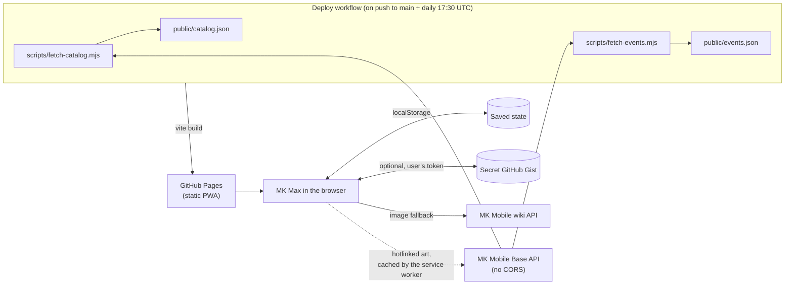
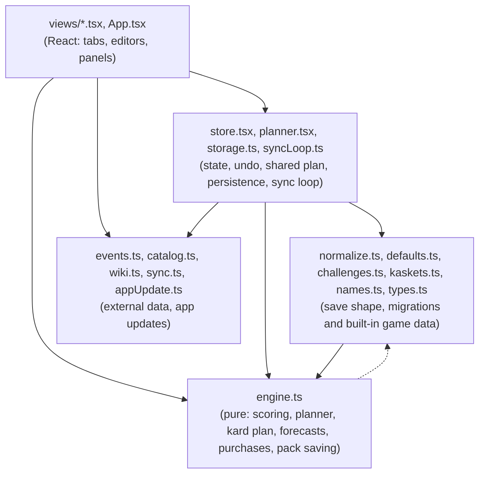
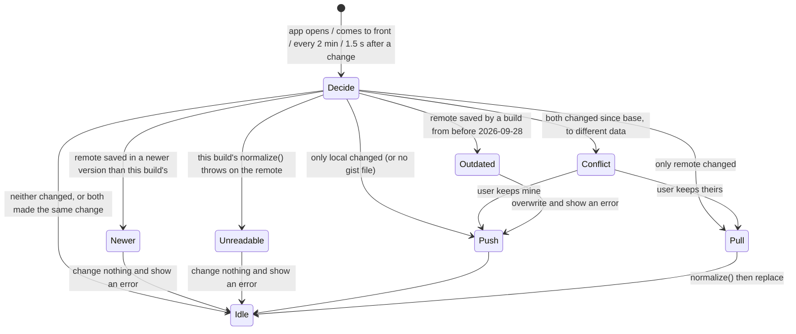

# Architecture

How MK Max is put together and why. For the scoring maths, see [How it works](how-it-works.md). For setup and the file-by-file layout, see [Development](development.md).

## System context

MK Max is a static, client-only PWA. There's no backend: everything the app knows lives in the browser, and the only outside services it calls at runtime are GitHub (optional sync) and the MK Mobile wiki (an image fallback). Card art is loaded straight from MK Mobile Base and the wiki.

Two constraints shape this:

- **MK Mobile Base doesn't allow cross-origin requests**, so the browser can't call it. The deploy workflow fetches the catalog and the event schedule at build time and ships them as static JSON. When the site is down or its data looks wrong, the deploy ships the copies that are live again, or the committed ones if those can't be downloaded. The schedule script also reads the live `events.json` to keep Realm Klash weeks the site has dropped.
- **No server to run or pay for.** Personal data stays on the device; sync goes through a gist the user owns, using their own token.

## Layers

- **`engine.ts` is plain TypeScript with no React and no I/O.** It takes an `AppState` and a `now` and returns plans. Its imports beyond types (the dotted edges) are `kaskets.ts`, for the Kasket exclusion list, and `nameKey` from `names.ts`, which both use to match names (the Realm Klash gear list is matched the same way); nothing it calls fetches. `nameKey` lives apart from `catalog.ts`, which downloads the catalog and uses React, and `engine.pure.test.ts` checks the engine loads without React. That's what makes the planner unit-testable (`engine.test.ts` is the biggest test file) and lets scripts reuse it. Keep it that way: anything that needs the clock, the network or the DOM belongs in a view, the store or an `Ext` module, and gets passed in. It also holds the rules views apply when they change data, like logging a purchase (`recordPurchase`), saving a pack from the editor (`editedPack`, `packEndOnSave`, `editorSeasonEnd`, `seasonMoveOnSave`, `savePack`, `addPool`), removing a rarity with its Kaskets (`removeRarity`), moving a rarity past the neighbour the screen showed (`moveRarity`, so a tap after a sync moved either of the two moves nothing rather than the wrong rarity), saving the Blood Ruby gear order after ↑/↓ (`moveInGearOrder`), which expired packs Clear expired keeps (`keepWhenExpired`), which tower a typed name is and how the Tower list spells it (`towerKey`, `towerSpellings`, shared by Cards, Tower gear and Paste a list, which leave out cards under a rarity a sync removed), and fixing a tower's spelling on every card naming it (`respellTower`), so those are tested too. The editor works on a copy of the pack, so `editedPack` lays its changes over the pack as it is when saved: Already bought and the end date keep a purchase or season move that landed meanwhile.
- **`store.tsx` owns the single `AppState`.** Every change goes through `update(recipe, undoLabel?)` (the label can be a function, called after the recipe, when it counts what changed; a recipe that finds nothing to change returns `noChange`, and nothing is saved, so a tap on a screen a sync has made out of date can't stamp this device's copy as newest), which clones the state, applies the recipe, removes finished cards (`pruneDone`, which first stores a goal of max on Realm Klash gear so older copies of the app keep it), stamps `updatedAt` (with `SyncLoop.nextStamp`, so the stamp is always after this device's last one and the last agreed one, whatever the clock says), saves to localStorage and schedules a sync push. Changes the app makes by itself that every device derives the same way (catalog art) pass `{ auto: true }`, which saves them without stamping or pushing, so they can't cause sync conflicts. A change whose first steps were saved without Undo can pass `{ undoFrom }` to adjust the state its Undo goes back to: a Tower box saves as it's typed, so when its finish re-spells the tower on other cards, Undo puts the typed card back too. `{ alsoUndo: true }` carries a change with no Undo of its own on from the Undo entry showing: Add card's Add goes back to where that Undo did and puts "Added <name>" before its label (newest first, so a phone's one-line bar shows it), since Undo puts the whole save back and so takes the new card out too. With no Undo showing, the Add gets none. The store also clears the entry showing at once (not only at the next render) when a sync, `replace` or the newer-save hold drops the bar, and `undo` reads that, so nothing in the same moment can put back a copy from before another device's changes. `undo` and `dismissUndo` take the entry the Undo bar showed when it was pressed and do nothing once a newer one has replaced it (pressing the bar can finish a Tower box, which puts a new entry there before the click lands). The bar's time only runs while the page is visible. The season-end move from the schedule is a normal change, since which packs it moves depends on when it runs, except on a fresh install (no stamp, no packs): stamping that would make a new device's first sync a conflict instead of a pull. It waits for `sync.settled` (this launch's first sync attempt has finished, whatever the outcome) so it usually runs on the other devices' latest data.
- **The plan is derived, never stored.** `PlanProvider` in `planner.tsx` works out `buildCtx(state)` and `buildPlan(ctx, now)` once per change and whenever the clock moves on (once a minute, and when the app comes back after half a minute or more in the background or is restored from the back-forward cache), and every view reads them through `usePlan()`, so the Packs badge and the Plan tab share one run of the planner. Nothing derived is saved, so there's no cache to invalidate beyond React's own memos.

## State model

One JSON document, `AppState` in `types.ts`: rarities (fusion and kard tables), currencies, cards, packs, weights, and a few lists (gear order, dismissed shop packs, the Maxed record). It's saved whole to localStorage under `mkmax:v1` and synced whole to the gist. If that save can't be read at startup, `load()` in `storage.ts` copies it to `mkmax:v1:unreadable` before the fresh state is saved over it, and resets the sync `baseUpdatedAt` to 0 so the first sync pulls the gist's copy rather than counting the empty state as agreed. Settings → Data offers the copy as a download until the user discards it. A save from a newer version than this build's (`fromNewerApp`) is read for display but held: `save()` writes nothing, `update`, `replace` and Undo in `store.tsx` refuse changes, and sync never pulls or pushes, until the newer build loads (the new-version bar's Reload, or reopening with no copy of MK Max open; the hold looks for it with `checkForAppUpdate`). The hold starts at `load()` (a deploy rolled back past a version bump) or, through a `storage` event, when another tab on the newer build saves while this one is open (`holdIfNewer`, which throws on text that isn't JSON rather than reading past it); that tab keeps showing the data it had. Otherwise this build would save the data back without the fields it doesn't know, and the next sync could push that over the synced copy. Export backup writes the save as stored (`savedText`), not this build's reading of it, so a backup taken meanwhile keeps the newer fields. A held save whose upgrades fail in `normalize()` stays under `mkmax:v1` rather than being moved aside as unreadable; one that isn't valid JSON has no version to read, so it still goes the unreadable way.

Decisions worth knowing:

- **Finished cards leave the card list.** Reaching a goal removes the card, its drop entries and any store item that only sold it. Undo is the safety net. The card list is a to-do list for maxing; a card that leaves at its top level goes on the Maxed record instead (`AppState.maxed`: name, rarity and day, added in `pruneDone`), which the planner never reads. Completion there comes from `completion` in `catalog.ts`, against MK Mobile Base's catalog. A card on the record isn't added again (`onMaxedRecord`, which checks a key set cached per record array, `maxedKeys`; the record is never changed in place, so the cache stays right). Two things take a card off the record: a Paste a list line with a Stage (`unmarkMaxed`), or ✕ on the Maxed page. A Settings rule change prunes cards without recording them (`update`'s `ruleChange`, `pruneDone`'s `record`). A new card pasted at its top level (`atTopLevel`) goes on with no day (`recordMaxed`). Removing a rarity removes its entries too (`removeRarity`).
- **A Kasket stores its rarity, not its drops.** `Pack.kasket` names the rarity, and `packDrops` works out its drops from the cards each time (`kasketPool`: the cards you don't own, minus the newest from the latest update in `kaskets.ts`, then cards short of max for a rarity tracked to max). Everything that reads drops (`packEV`, `rankPacks`, `buildPlan`, `rankTargets`, the pack list) goes through `packDrops`, so unlocking a card updates the odds with nothing stored to go stale. Each rarity's eligible cards are kept per `Ctx` (a `WeakMap`), since the planner asks for every Kasket on every pass. `kasketShape` keeps a Kasket at one card per purchase with no drops or store item; `savePack` and every load (`normalize`) apply it, so an import or synced save can't give a Kasket odds the screen hides, and a `null` or empty rarity means it isn't a Kasket.
- **Levels are stored as copy counts**: 0 = not owned, 1 = F0, 11 = F10, then ascension. `levelLabel` turns them into F/A labels. Version 1 stored F1 as the first copy, which is why `migrateV1` exists.
- **Every load goes through `normalize()`**: localStorage, imports and sync pulls. It runs each migration once, by `version`, so a later user edit (deleting a rarity, removing a tag) sticks. See [Development → Saved data and migrations](development.md#saved-data-and-migrations).
- **Per-device settings aren't in `AppState`.** Sort orders, folded cards and the sync token live in their own localStorage keys (`mkmax:cardSort`, `mkmax:packSort`, `mkmax:folded`, `mkmax:sync`), so they never sync or get exported.

## Planner (LLD)

`buildPlan` in `engine.ts`, run once per change (and whenever the clock moves on) by `PlanProvider`:

1. **Kard allocation** (`allocateKards`, inside `buildCtx`). For character rarities, spend its Fusion Up Kards one step at a time on the step with the best `cardWeight / kardCost`, tie-breaking on the card with the fewest steps left to its goal. For gear rarities, finish whole pieces instead, cheapest total first (ties: higher level, then name), stopping at the first piece the kards can't finish and recording it as `next`. Pieces with a step that has no kard cost can never be finished and are listed as `stuck`. Realm Klash gear and cards marked No kards (`Card.noKards`) are excluded, and so is any rarity not tracked to max, since only those have a kard box. The result is how many copies kards will supply per card, which the next step treats as worth less.
2. **Copy value** (`copyValue`). The `g`-th extra copy of a card falls into a phase (unlock, to F3, packs only for a No kards card, normal, covered by kards, maxed) with its own multiplier, times the card's weight (guest, Kameo, challenge), times a closeness bonus. `gainValue` integrates this over fractional expected copies.
3. **Blood Ruby gear first.** For Blood Rubies only, walk `gearQueue` in order and buy each piece's cheapest store item until the piece is maxed. If the next copy isn't affordable, stop and save for it; nothing else is bought with rubies.
4. **Greedy per currency.** Repeatedly buy the affordable pack with the best `packEV / cost` (times `limitedBoost` if it has an end date), adding its expected copies to a shared `gained` map so later buys, in any currency, see diminishing returns. A Kasket's pool is worked out from `gained` before each buy, so once every new card is expected, later Kaskets are valued from the cards short of max. Stop when nothing affordable has positive value. The best pack you can't afford becomes `saveFor`.
5. **Forecasts** (`daysToAfford`, `gearForecast`) divide shortfalls by the currency's `perDay`.

Greedy-by-ratio isn't optimal for a knapsack in general, but purchases are small next to balances, values are estimates anyway, and the result is explainable to the user line by line. That trade is deliberate.

## Sync

The loop itself is `SyncLoop` in `syncLoop.ts`, plain TypeScript with GitHub, the state and timers passed in; `store.tsx` wires it to React. `decideSync` in `sync.ts` compares each side's `updatedAt` with `baseUpdatedAt`, the stamp both last agreed on. When both sides moved but hold the same data apart from the stamp (each device moved the season end by itself), `sameData` makes it a no-op and both stamps count as agreed. While a conflict waits for the user, background syncs hold off, and a sync that ends in a conflict or an error doesn't reschedule itself; the regular pulls retry. Keeping this device's copy first re-reads the gist: if the other device pushed again while the prompt was up, the prompt shows that copy instead (one from an outdated build is written over, with the outdated-build message, as a sync does). Otherwise it restamps the kept copy above both copies (the outdated branch does the same), so the other device pulls it, or asks if it has changed since, rather than overwriting it with its own next edit. Data saved in a newer version than this build's is neither pulled nor pushed (an app left open across a deploy would otherwise save it back in its older format and drop fields, and the newer build would then rerun one-time migrations over the user's later changes); the loop shows an error and looks for the new version (`lookForUpdate`), which only brings up the new-version bar, since the app never reloads by itself. Import backup refuses such a file too. The same goes for a gist copy this build's `normalize()` throws on (`canRead`): pulling it would fail, and pushing or asking would let a device whose own save couldn't be read upload its fresh data over it, so the loop shows an error and waits for an update. If applying the gist's copy fails after Keep theirs anyway, it shows that error rather than leaving a prompt whose buttons do nothing. Edits are stamped with `nextStamp`, after both this device's own stamp and `baseUpdatedAt`: after a pull, the agreed stamp comes from the other device's clock, and a device whose clock runs behind would otherwise stamp its edits as older than it and never push them. A sync that finishes after the user disconnected changes nothing. A copy this device wrote whose answer never came (GitHub may have saved it) isn't counted as agreed, so an edit made before the next sync shows the which-copy prompt with both copies this device's (Keep mine is right); so can a Connect that made a gist just before another tab's newer save stopped it, once the user connects again: the prompt is rare and safe, so the loop keeps no record of such writes. Each GitHub request, reading the answer included, gives up after 30 seconds (`inTime` in `sync.ts`), so a sync, and a pull waiting on it, always ends. It's last-writer-wins with conflict detection, not a merge: the data is small and edited by one person, so asking which copy to keep is simpler and safer than merging fields.

## Offline and updates

`vite-plugin-pwa` precaches the app shell. `main.tsx` asks for persistent storage (`navigator.storage.persist()`) at startup, since without sync localStorage is the only copy of the data and browsers may clear it. `catalog.json` isn't precached or kept for offline use: `catalog.ts` downloads it when first needed (a recent copy in the browser's own cache may answer), and again (`refreshCatalog`, past that copy, which may predate the daily deploy) on pull to refresh, on coming back after an hour, and on coming back when no download has worked yet; a pull while the first download is out shares it. Lookups meanwhile get the copy already downloaded, a download that hangs gives up after 30 seconds with a plain message (shown by Find images), one that answers with JSON but no card list (or an empty one) counts as failed and entries with no kind or name are left out, a lookup whose own download fails gets a copy a pull brought in meanwhile, a first download that lands after a fetch-again's doesn't replace the newer copy, and only a copy that differs, or the first that works after a failed download, bumps `useCatalogVersion`, which App's art lookup, the card list's rarity check and the Maxed page list so they read it again. `events.json` is network-first (it changes daily), falling back to the cached copy after 4 seconds on a connection that hangs, and card art from MK Mobile Base and the wiki is cache-first for 90 days. The build stamps the short commit id and commit date into `__APP_VERSION__`, shown at the bottom of Settings. It's the commit date, not the build date, so the daily scheduled deploy, which rebuilds the same commit with new `events.json` and `catalog.json` (neither precached), builds identical app files: the service worker doesn't change and no device downloads the app again or shows the new-version bar. The plugin runs in prompt mode, with `clientsClaim` turned back on (prompt mode leaves it off), so the worker takes over a first visit at once and keeps art and the schedule for offline use from the start: a new worker found while the app is open waits, and `appUpdate.ts` flags it (`useAppUpdateReady`) so App shows a bar with Reload, which calls `applyAppUpdate` to switch to it. The app never reloads by itself, since every rule for when a reload was safe missed some unsaved work (a half-filled form, a paste, a pull being logged, an Undo); it also loads the new version the next time it opens with no copy of it already open. Only the copy whose Reload was tapped reloads: on `controllerchange` once the new worker takes over, or, on a page the old worker didn't control, once the new one is active (or if a newer one replaced it first). The plugin's own reload of every open copy (`onNeedReload`) is turned off, so another open copy keeps its bar, and its Reload then just reloads. The plugin stops reporting new workers after the first one it sees, so `appUpdate.ts` also watches the registration's `updatefound`, and a check that leaves one waiting brings up the bar too. A worker taking a page over (`controllerchange`) brings it up too: a copy frozen in the background while another copy took the new version never saw it waiting, and its Reload then just reloads. Both a version waiting and one taking over count only once a worker ran the site before the page: it started under one, or the site already had one active when it started (a hard reload runs no worker but has one, so it's offered new versions like any page). A first visit's own install never counts, however fast it installs, as no worker was there before; a later version then does. The half-hour wait before looking again on return counts from the start too, since the browser looks then, and a last look later than now (the device clock went back) counts as long ago. `checkForAppUpdate` looks for a new worker, and stops once one is waiting: pull to refresh (which doesn't wait for it), the app coming back to the screen after half an hour (a visibility change or a back-forward cache restore), the sync loop finding data from a newer build or a gist copy it can't read, another tab first saving data from a newer build, and importing a backup from one all call it. Pull to refresh never reloads, so where no service worker runs (a private window, some in-app browsers) a new version loads the next time the app opens. A sync already waiting on GitHub when another tab saves data from a newer version stops once GitHub answers (`SyncDeps.held`): it neither writes, applies nor reports anything, as a held tab doesn't at startup. An upload already sent still lands (a request can't be called back), so the gist may briefly hold the older copy; the newer tab then sees a copy it didn't make and asks which to keep, so nothing is lost unseen. A held tab starts no sync, Keep mine or theirs, or Connect (the regular pulls included), and a Connect still looking for the gist saves no sync settings and goes back to off, even if GitHub's answer is an error; Connect says whether it connected, so Settings keeps the token when it didn't. Once the gist is found it's connected, and a hold during its first sync stops that sync like any other. `main.tsx` passes the plugin's `registerSW` in, so the store and screens use the rest of `appUpdate.ts` without loading the plugin (`appUpdate.test.ts`).

## Styling and layout

Styles are Tailwind CSS v4 utilities, built at compile time by `@tailwindcss/vite`, so there's no runtime styling dependency. `src/styles.css` holds the theme tokens (`@theme`, with Tailwind's default palette removed so only the app's colors exist) and the base control styles. Shared class sets are in `src/classes.ts`. Each set owns its properties, so nothing should add a second utility for the same property on the same element at the same breakpoint.

`App.tsx` has one layout that changes at `md` (768px). Below it, a header, a 720px page column and a bottom tab bar, which is the phone design and must stay as it is. From `md`, a left rail (88px, 220px from `lg`) replaces the header and tab bar, the page grows to 1400px, and views add columns. The rail is moved with `order-first` rather than in the DOM, so keyboard and screen reader order don't change. Only `<main data-scroll-root>` scrolls; pop-ups are portalled to `<body>` with `data-modal`, and `Modal` makes `#root` inert while one is open and gives focus back to the opener when it closes. `scrollRoot.ts`, `PullToRefresh` and `useSwipeTabs` find these by attribute, so restyling can't break them.

## Testing

Vitest covers the pure modules: the engine, migrations via `normalize`, sync decisions and the GitHub requests' time limit, the sync loop (two devices against a fake gist, with requests held open to edit or disconnect mid-sync), the list parser, catalog and event name matching, the schedule script's parsing (including leaving out an entry with no name, and failing when a whole list has none) and season carry-over (`scripts/schedule.test.mjs`), and the download scripts failing without writing when MK Mobile Base can't be reached or its catalog answers look wrong or come too slowly, with a time limit on every request, and, when the answers are healthy, writing the catalog (with a new unfinished card, no item count or an accepted drop, compared with the newest earlier copy, and leaving out items the site hasn't finished, with no name or slug) with each card's https thumbnail, or its https full art when the thumbnail isn't https (`scripts/fetch.test.mjs`). A few screen tests render the real store and plan in jsdom with Testing Library: the logo and the Cards tab's switch to Tower gear, the shared plan and clock, undo labels, the Undo bar (its time, counted only while the app shows, and which change Undo and ✕ act on), buying and fusing from Packs, Cards and the Plan, taps that save nothing once a sync has made the screen out of date (and Settings rows edited by id), moving a rarity in Settings (where the page scrolls and keyboard focus goes after a move), Clear expired, Realm Klash gear not on sale, a save from a newer version (the notice on every tab, the pack editor's Save, and Settings' backups and sync), the Tower gear kard threshold filter (which gear and towers it lists, and a piece tapped up to the threshold staying listed until the filter changes), the Cards Tower list (picking, adding and clearing a tower, its Undo, a sync or a page switch while a new name is typed, and one tower spelled two ways), the name order of the card lists on Packs and in the pack editor, and the Maxed page (its record, completion and Paste maxed cards) (see [Development → Tests](development.md#tests)). The event schedule's downloads (again on return, and when two overlap) and the new-version bar (flagged, never reloading by itself, and only the copy that tapped Reload reloading) are tested in jsdom too, in `events.restore.test.ts`, `events.firstload.test.ts` and `appUpdate.test.ts`; `pwaConfig.test.ts` checks the build's service worker waits for Reload and takes over a first visit, `main.test.tsx` that starting the app registers it through the plugin, `App.catalog.test.tsx` that pull to refresh fetches the card catalog again (and Cards reads the new copy), that a card gets its art once the catalog first loads after failing, and that the art fill keeps an image a sync pasted meanwhile, `catalog.refresh.test.ts` that a fetch-again keeps the copy it has if it fails, answers lookups from it meanwhile, gives up on a download that hangs and copes with downloads that overlap, and `catalog.return.test.ts` that coming back fetches it again after an hour or a failed download. The rest of the views are thin over the engine and are checked by running the app. CI runs lint, tests and a build on every pull request (`.github/workflows/ci.yml`, required to pass before a merge), and lint, tests and a build again before every deploy (the deploy tests the committed catalog and event schedule, then downloads fresh copies, which the download scripts check). `src/workflows.test.ts` checks the pull request workflow keeps those steps on every pull request, with none skipped or allowed to fail, a read-only token that neither workflow leaves on disk, the real lint (failing on warnings), test and build scripts, the deploy's Node version, the `/mkmax/` path the site is served from, and the `check` job name main's ruleset requires. It also checks that the app's runtime dependencies are still only React and React DOM, with yaml a dev dependency, so adding one is a deliberate change there. It also checks that in the deploy workflow only the publishing job can write to Pages, and that job runs nothing but the Pages deploy and keeps the `github-pages` environment the deploy status command in `CLAUDE.md` finds deployments by (and it runs that command's jq on each kind of run, so a deploy a newer one cancelled never reads as failed), and that a deploy whose catalog or schedule download fell back fails its run after publishing. A pull request runs its own copy of the workflow, so a change that drops or mutes the test step isn't caught on that pull request; this test catches it locally and at deploy time. `src/pregate.test.ts` checks gstack's pre-ship check runs every test file when `package.json`, `package-lock.json`, `tsconfig.json` or `vite.config.ts` changes, and that Vitest leaves Claude Code worktrees and gstack's `.gstack` folder out of the test run.
